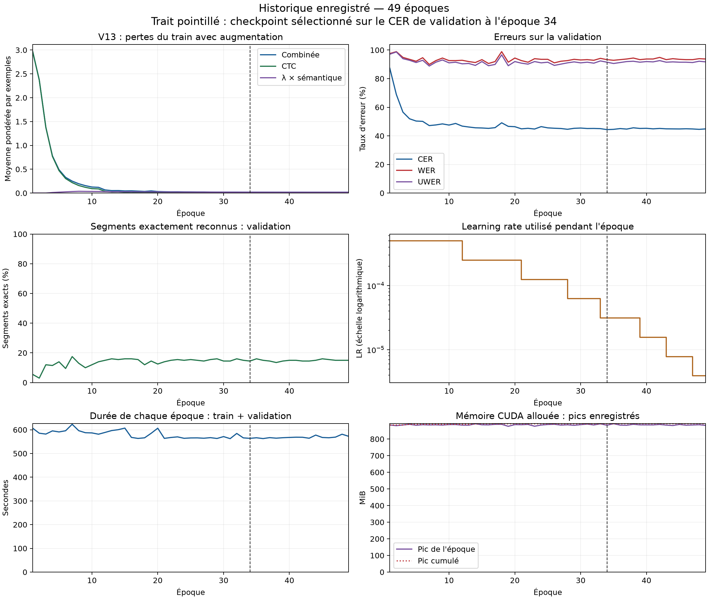

---
language:
- ha
tags:
- ocr
- ajami
- handwritten-text-recognition
- crnn
- ctc
- semantic-supervision
- IX-World
library_name: pytorch
datasets:
- IntelligenceResearchLab/Hausa
---

# Hausa Ajami OCR V13 — supervision auxiliaire AfriBERTa — IX-World

Entraînement local et publication le **18 octobre 2026**. Résultat expérimental :
**V13 ne réduit pas les erreurs de V10/V12 sur ce split. Le surapprentissage persiste.**
Les objectifs CER ≤ 20 % et WER ≤ 30 % ne sont pas atteints.

## Résultats réellement mesurés

| Partition | Segments | CER | WER | UWER | Segments exacts |
|---|---:|---:|---:|---:|---:|
| train | 4972 | 0.0021% | 0.0094% | 0.0094% | 4971/4972 (99.9799%) |
| validation | 200 | 44.3739% | 93.2886% | 91.4989% | 29/200 (14.5000%) |
| test | 401 | 39.0987% | 86.3060% | 86.0136% | 2/401 (0.4988%) |

**49 époques exécutées**, checkpoint à l'époque **34**, minimum
du CER de validation. Même checkpoint pour les trois ensembles, originaux sans
augmentation. Train : une seule erreur de caractère et de mot ; les erreurs restent
élevées sur les sources tenues à l'écart. [Comparaison V9–V13](COMPARISON.md).
Les résultats de test sont rapportés après entraînement ; aucun réglage n'a été
effectué pendant la publication. Leur consultation répétée dans cette campagne
devra être prise en compte pour les futures affirmations de généralisation.

## Ce que la supervision sémantique a réellement utilisé

- OCR **initialisé aléatoirement**, sans reprise des poids de V10 :
  `from_scratch=true`, `ocr_checkpoint_initialization=null`.
- Enseignant figé : [castorini/afriberta_base](https://huggingface.co/castorini/afriberta_base),
  révision `95b703f498c9cee56be5f5bbc5140022dc86099e`. Préparation sur CPU seulement ;
  aucune référence de validation ou de test n'est encodée comme cible auxiliaire.
- Moyenne des états cachés des tokens de la transcription, hors padding et tokens
  spéciaux, puis normalisation L2, dimension 768. Les offsets sont calculés avec
  un tokenizer byte-fallback vérifié contre le SentencePiece original pour chaque texte.
- Langue **haoussa renseignée pour tous les exemples**, d'après le corpus.
  Ce run n'apprend pas à détecter la langue et ne démontre pas de généralisation multilingue.
- **Aucune époque ni localité linguistique renseignée** ; entrées inconnues masquées.
  `time_available=false`, localités `[null]`. **Zéro contexte textuel complémentaire
  vérifié** : les cibles encodent les segments latins disponibles, souvent des mots isolés.
- Aucun résultat de désambiguïsation historique, régionale ou de polysémie n'est établi.
  Un encodeur contemporain ne suffit pas à démontrer cette capacité. Ni traduction,
  correction libre, enrichissement automatique continu ni auto-apprentissage en production.
- L'enseignant préentraîné apporte des connaissances externes ; seule la préparation
  de nos cibles est limitée au train. L'exposition antérieure du préentraînement aux
  textes du domaine n'a pas été auditée.

## Architecture et prétraitement exacts

**6,553,393 paramètres** : six convolutions gris, GroupNorm huit groupes,
ReLU, dropout spatial 0,1 après les poolings ; BiLSTM deux couches de 256 unités
par direction, dropout 0,2, séquences empaquetées selon leur longueur réelle.
Métadonnées : embeddings langue/localité de 16 dimensions chacun, branche temporelle
de 16 dimensions, modulation FiLM bornée par 0,1. Dropout séquentiel 0,2 puis
classification CTC à 80 classes (BLANK=0, UNK=1).
Branche auxiliaire : attention sur les pas valides, projection 512→768 et LayerNorm.
Elle supervise l'encodeur pendant l'entraînement ; elle ne réordonne pas les sorties.

Hauteur 96, largeur proportionnelle, Lanczos, miroir horizontal RTL, un canal
gris normalisé dans [-1,1], padding blanc +1. **Pas de canal d'encre locale**.
Décodage CTC glouton, répétitions fusionnées et BLANK supprimé, sans beam search,
lexique ni modèle de langue au décodage. Aucune détection des lignes sur page complète.
La tâche est image Ajami → texte latin, sans annotation Ajami intermédiaire.

## Données, split et normalisation

Dataset `IntelligenceResearchLab/Hausa`, révision figée `1fb85fa070b6cf6432f1d45d21f78851d57f8944`.
**4 972 train / 200 validation / 401 test**, 5 573 exemples valides. Split par manuscrit
et groupe de copiste connu, sources 1 et 2 regroupées, mêmes identifiants et vocabulaire
que V9–V12. Toutes les sources de validation/test sont absentes du train.
Le test a été reconstruit sur le corpus complet ; il n'est pas le test public initial de 400 images.
Trois chemins corrigés, annotation répétée identique retirée ; les deux images identiques
`a_ajami_03400.png` et `a_ajami_03401.png` aux références contradictoires restent exclues.
Les quasi-doublons et les copistes non identifiés restent à contrôler.

Split SHA-256 : `fdb453e5f92147f31bc236998e067823b07bdce4b965811081b1d54edcaae7b5`.
Vocabulaire construit sur le train seul : `f92c368520aad95130f909a708fb58864e1f766f10f87d18c96690d1b20ced59`.
CER/WER stricts conservent casse, espaces et diacritiques NFC. Calcul global :
distances d'édition cumulées divisées par les longueurs de référence cumulées.
UWER : Unicode casefold, NFD, suppression des marques Mn, puis NFC et separation des mots par les espaces ; ponctuation et lettres haoussa non decomposees conservees.
Les compteurs bruts, dénominateurs et prédictions sont tous publiés.

## Entraînement sur GTX 1060 6 Go

- Huit vues fixes par image train : original, luminosité/contraste, épaisseur d'encre,
  résolution, flou, rotation, géométrie et combinaison modérée ; paramètres exacts
  et graines dans `source/hausa_ocr/augmentations.py`. **39 776 vues par époque**.
  Validation et test sans augmentation. Les vues ne sont pas des images indépendantes.
- Float32 ; microbatch jusqu'à 6 exemples et 600 000 pixels après padding ; accumulation
  de 4 microbatches (jusqu'à 24 exemples par mise à jour), workers 0, groupes de largeur.
- AdamW LR 0,0005, weight decay 0,001, clipping de norme 5 ; ReduceLROnPlateau
  sur CER validation, facteur 0,5, patience 3, minimum 0,000001.
- Perte = CTC + λ × (0,5 × cosinus + 0,5 × contrastive). Température contrastive 0,1,
  positifs multiples pour un même texte/contexte, négatifs de même langue dans le
  microbatch réel seulement. L'accumulation n'agrandit pas le groupe contrastif.
- λ=0 aux époques 1–3, puis 0,02 à 0,10 des époques 4 à 8 ; ensuite λ=0,10.
- Maximum 100, minimum 30 époques, patience 15 avec seuil 0,0005 pour l'arrêt.
  Sélection des poids au minimum absolu du CER validation. Graine 42 ; cuDNN benchmark,
  pas de garantie de déterminisme bit à bit. Une seule graine mesurée.
- PyTorch 2.5.1+cu121, CUDA 12.1, Python 3.12.14.
- Durée enregistrée train + validation : **7.86 h**,
  hors préparation de l'enseignant, sauvegardes et bilan final ; pic **892.3 MiB
  alloués par PyTorch**, pas la mémoire totale occupée/réservée sur le GPU.

V13 change aussi normalisation, dropout, empaquetage, LR, régularisation et batching.
Cette comparaison n'isole donc pas l'effet de la seule perte sémantique. Une ablation
λ=0 avec la même architecture et plusieurs graines reste à réaliser avant toute
conclusion causale. Aucune nouvelle expérience n'a été lancée pour cette publication.

## Historique complet et intégrité

[Toutes les époques et unités](EPOCHS.md) · [CSV brut](history.csv) · [JSON numérique](epochs.json)
· [Bilan train/val/test](metrics.csv) · [Vérifications](verification.json).
La loss combinée, CTC, cosinus, contrastive, λ et le nombre de mises à jour sont
publiés séparément. Les CER/WER/UWER train et test ne sont pas mesurés à chaque époque.



[Courbes vectorielles](training_curves.svg). Aucun lissage ni score reconstitué.
Code d'entraînement **et d'évaluation** dans `source/` (même version), empreintes
dans `config.json`, commit `32a9a0ece7fd27177068bced053a179cc17a37d7`.
Checkpoint SHA-256 : `3b75305f19eb604974b93f47e4aeb99f020299e2ab97b7c24497b4dc004c6aac`.
Les manifestes et cibles auxiliaires du TRAIN sont dans `semantics/` ; SHA-256 du cache
`78182ac20e5fc53943bf8f964f18eeda8dde609c7d63ea8e3266bcb3997f4faf`. Les poids AfriBERTa ne sont pas redistribués.
Les images du corpus ne sont pas incluses dans le package.

## Utilisation locale sans réentraîner

Télécharger le package complet HF ou le ZIP de la release. Installer PyTorch et Pillow
compatibles avec votre machine ; les versions d'entraînement sont indiquées ci-dessus.
L'enseignant AfriBERTa et Transformers ne sont **pas nécessaires** à l'inférence.

```cmd
python infer_v13.py --model-dir "CHEMIN_PACKAGE" --image "CHEMIN_IMAGE.png" --source 15 --device cpu
```

`--source` doit désigner la provenance documentaire connue dans le contexte archivé ;
il ne représente pas un label prédit. Ici tous les contextes sont identiques (haoussa,
époque/localité inconnues). La prédiction peut varier légèrement avec le padding d'un
lot, car GroupNorm agrège aussi les positions spatiales : les résultats publiés utilisent
les microbatches de validation/test archivés et les dimensions originales du split.

Pour recalculer le bilan des trois partitions, sans entraînement (cela utilise le test) :

```cmd
python source\train_v13.py --dataset "D:\ai_test\Hausa_repo_2026-10-15" --protocol "CHEMIN_PACKAGE" --context "CHEMIN_PACKAGE\context.json" --semantics "CHEMIN_PACKAGE\semantics" --output "CHEMIN_PACKAGE" --evaluate-only --device cpu
```

Pour un nouvel entraînement indépendant à partir de zéro, remplacer `--evaluate-only`
par `--fresh-start` et utiliser **un nouveau dossier --output**, les mêmes options et
la même révision du dataset. Sous Windows, les raccourcis du dépôt sont décrits dans
`source/README_V13.md`. Les poids ne sont pas un AutoModel Transformers.
La publication est un téléchargement de modèle ; elle ne crée pas de serveur d'inférence.

## Attribution et limites

Code, adaptation et entraînement : **IX-World**.
Projet : https://github.com/IX-World/OCR-AJAMI-Hausa
Les manuscrits, annotations, crédits et droits du corpus restent ceux de leurs auteurs
et du dataset d'origine. L'enseignant garde ses crédits et conditions propres.
Cette fiche ne crée pas de nouvelle licence pour ces ressources.
L'architecture CNN–BiLSTM–CTC est établie ; ni une GPU de 6 Go ni l'ajout d'une
perte sémantique ne suffisent à établir une nouveauté scientifique ou une amélioration.
Le modèle nécessite une relecture humaine ; ces résultats ne montrent pas une
transcription autonome fiable.

## Audit du split et interpretation de l'ecart validation/test

Audit du checkpoint `3b75305f19eb604974b93f47e4aeb99f020299e2ab97b7c24497b4dc004c6aac` et du split `fdb453e5f92147f31bc236998e067823b07bdce4b965811081b1d54edcaae7b5`.

Les exemples et leurs references couvrent exactement le corpus corrige, en tenant compte des exclusions documentees. Aucun identifiant ni hash de pixels exact n'est partage entre partitions. La recherche de quasi-doublons n'a pas ete realisee. Les CER, WER et UWER ont ete recalcules depuis les predictions et leurs references : ils correspondent aux fichiers de scores.

| Composition | Train | Validation | Test |
|---|---:|---:|---:|
| Segments | 4972 | 200 | 401 |
| Mots | 10657 | 447 | 2052 |
| Mots moyens par segment | 2.14 | 2.23 | 5.12 |
| Segments d'un seul mot | 3777 | 156 | 126 |
| Mots stricts absents du train (occurrences) | 0 | 144 | 505 |
| References completes deja presentes dans le train | 4972 | 89 | 65 |
| Segments de sources absentes du train | 0 | 200 | 401 |

La validation contient 78.00% de segments d'un seul mot, contre 31.42% au test. 401 exemples de test proviennent de sources absentes du train ; la repartition complete par source est dans split_audit.json. Ces differences de composition doivent etre prises en compte pour interpreter les scores de validation et du test du protocole.

| Groupe | Validation N / mots | Validation WER | Test N / mots | Test WER |
|---|---:|---:|---:|---:|
| Source presente au train | 0 / 0 | non mesure | 0 / 0 | non mesure |
| Source absente du train | 200 / 447 | 93.29% | 401 / 2052 | 86.31% |
| Segments d'un mot | 156 / 156 | 81.41% | 126 / 126 | 109.52% |
| Segments de 2 a 4 mots | 2 / 5 | 120.00% | 12 / 43 | 132.56% |
| Segments de 5 mots et plus | 42 / 286 | 99.30% | 263 / 1883 | 83.70% |
| Reference complete vue au train | 89 / 89 | 68.54% | 65 / 65 | 96.92% |
| Reference complete non vue au train | 111 / 358 | 99.44% | 336 / 1987 | 85.96% |

Ces groupes decrivent des associations, sans isoler une cause unique. La longueur ne majore pas mecaniquement le WER, qui est normalise par le nombre de mots ; elle change notamment les conditions visuelles de reconnaissance. La validation intervient aussi dans la selection du checkpoint et ne constitue pas un second test independant. Le WER des sources connues et inconnues du test doit etre examine avant d'attribuer l'ecart aux seules sources. Les conventions d'annotation et la qualite visuelle n'ont pas ete relues integralement dans cet audit.

Le split et le checkpoint documentes restent figes pour comparer V9 a V12. Les decisions de repartition reposent sur les groupes de provenance et leurs effectifs. Le fichier de protocole indique si le test public initial est conserve ou reconstruit.

## Comparaison et publication

### Comparaison V9–V13 sur le même split — IX-World

Protocole commun : 4 972 train / 200 validation / 401 test, mêmes identifiants, vocabulaire et graine 42. Checkpoint de chaque modèle sélectionné sur son CER de validation.

| Modèle | Époque retenue | Époques exécutées | Test CER | Test WER | Test UWER | Segments exacts |
|---|---:|---:|---:|---:|---:|---:|
| V9 | 33 | 48 | 40.6935% | 86.9396% | 86.1598% | 5/401 |
| V10 | 39 | 54 | 34.8801% | 79.7758% | 79.2398% | 5/401 |
| V11 | 39 | 54 | 35.7136% | 83.4795% | 82.6998% | 9/401 |
| V12 | 50 | 65 | 33.5425% | 79.6784% | 78.8499% | 5/401 |
| V13 | 34 | 49 | 39.0987% | 86.3060% | 86.0136% | 2/401 |

**V13 n'apporte pas le gain attendu sur ce run.**

Par rapport à V10, V13 augmente le CER de **4.2185 points** (410 erreurs de caractères supplémentaires sur 9 719) et le WER de **6.5302 points** (134 erreurs de mots supplémentaires sur 2 052).

Par rapport à V12, V13 augmente le CER de **5.5561 points** (540 erreurs de caractères supplémentaires sur 9 719) et le WER de **6.6277 points** (136 erreurs de mots supplémentaires sur 2 052).

V13 reconnaît presque parfaitement le train, mais obtient 44,37 % de CER et 93,29 % de WER de validation ; le surapprentissage persiste. Les objectifs CER ≤ 20 % et WER ≤ 30 % ne sont pas atteints. V12 reste le meilleur CER de test observé dans cette série, sans preuve de supériorité générale ni de significativité : une seule graine est mesurée.

V13 est parti de poids OCR aléatoires, sans initialisation V10. L'enseignant AfriBERTa est préentraîné et figé ; ses cibles sont calculées exclusivement depuis les références du train. Langue haoussa renseignée, époque/localité inconnues et masquées, zéro contexte textuel complémentaire vérifié : aucun résultat de compréhension historique ou régionale n'est établi.

V10 : six convolutions gris, BatchNorm, BiLSTM non empaqueté. V11 ajoute le canal d'encre. V12 utilise neuf convolutions et deux canaux, avec dropout CNN 0,05 et batch 20. V13 : six convolutions gris, GroupNorm, séquences empaquetées, dropout 0,1/0,2, batch jusqu'à 6 et accumulation 4, LR 0,0005, weight decay 0,001, perte auxiliaire sémantique. Plusieurs facteurs changent : ni le bénéfice ni la régression ne peuvent être attribués à la seule sémantique sans ablation λ=0 et répétitions.

Les scores de test documentent les expériences terminées ; les choix suivants doivent reposer sur la validation. Les consultations répétées du test dans cette campagne limitent son rôle pour une affirmation finale indépendante. Les courbes par époque contiennent les scores de validation et les pertes train, pas des scores de test par époque. Les dénominateurs et compteurs sont dans comparison_v9_v10_v11_v12_v13.json.

Le chargement strict sur CPU et six prédictions du premier batch de validation ont été reproduits. Une inférence sur image seule, sans enseignant, a également été vérifiée.

Hugging Face : https://huggingface.co/IntelligenceResearchLab/Hausa-OCR-AJAMI-v13-20261015

GitHub : https://github.com/IX-World/OCR-AJAMI-Hausa/releases/tag/v13-hausa-all-grouped-20261018

Le nom HF conserve la date de référence de la campagne ; entraînement et publication réels le 18 octobre 2026.
