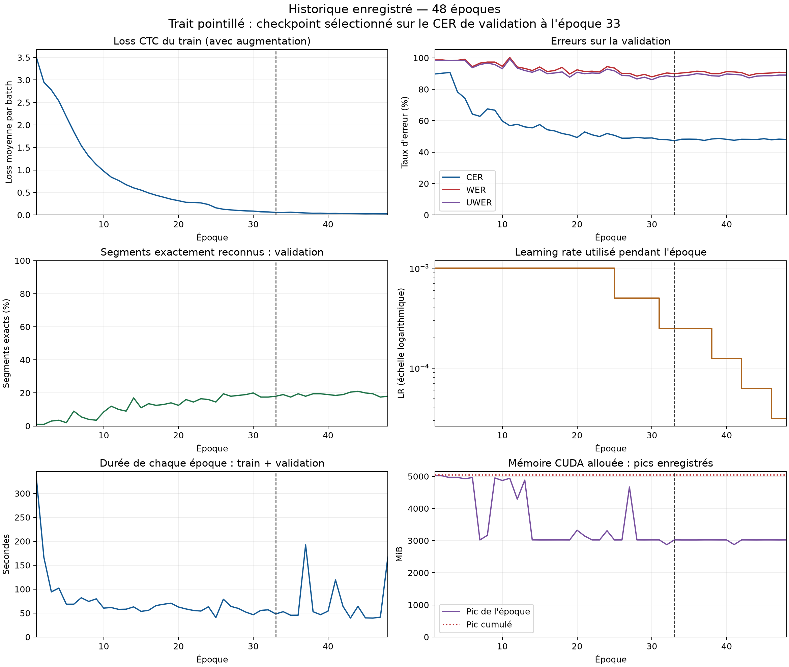

# Valeurs enregistrées à chaque époque

**48 époques exécutées ; checkpoint publié : époque 33, minimum du CER de validation.**

[CSV brut, précision d'origine](history.csv) · [JSON avec unités et provenance](epochs.json)

La loss du train est la moyenne des pertes CTC des batches pendant l'apprentissage avec augmentation. Les taux CER/WER/UWER et exact ci-dessous concernent uniquement la validation, sur images originales. Les CER/WER/UWER du train et du test ne sont pas enregistrés à chaque époque : ils figurent dans [metrics.csv](metrics.csv), pour le checkpoint sélectionné. Aucun score manquant n'a été reconstruit.

[Télécharger les courbes vectorielles SVG](training_curves.svg). Courbes brutes sans lissage ; le trait pointillé indique le checkpoint sélectionné.

## Optima observés sur la validation

| Mesure | Meilleure valeur | Première époque correspondante |
|---|---:|---:|
| CER | 47.2777% | 33 |
| WER | 87.9195% | 30 |
| UWER | 86.1298% | 30 |
| Exact | 21.0000% | 44 |

Seul le minimum du CER détermine le checkpoint publié ; les autres optima ne désignent pas d'autres poids conservés. Ces scores de validation interviennent dans la sélection et ne constituent pas des résultats de test indépendants.

## Apprentissage et validation — toutes les époques

Les taux sont exprimés en pourcentage ; les valeurs exactes non arrondies sont dans le CSV et le JSON. LR utilisé = apprentissage de cette époque ; LR suivant = valeur après le scheduler.

| Époque | Loss train | VAL CER % | VAL WER % | VAL UWER % | VAL exact % | LR utilisé | LR suivant | Temps (s) |
|---|---:|---:|---:|---:|---:|---:|---:|---:|
| 1 | 3.499769 | 89.7459 | 98.6577 | 98.2103 | 1.0000 | 0.001 | 0.001 | 330.875 |
| 2 | 2.950175 | 90.2450 | 98.6577 | 98.2103 | 1.0000 | 0.001 | 0.001 | 166.203 |
| 3 | 2.775831 | 90.6987 | 98.2103 | 98.2103 | 3.0000 | 0.001 | 0.001 | 94.328 |
| 4 | 2.531302 | 78.3575 | 98.4340 | 98.2103 | 3.5000 | 0.001 | 0.001 | 102.203 |
| 5 | 2.186955 | 74.2740 | 99.1051 | 98.4340 | 2.0000 | 0.001 | 0.001 | 68.531 |
| 6 | 1.850424 | 64.2015 | 94.4072 | 93.7360 | 9.0000 | 0.001 | 0.001 | 68.578 |
| 7 | 1.541042 | 62.7949 | 96.6443 | 95.7494 | 5.5000 | 0.001 | 0.001 | 82.031 |
| 8 | 1.302782 | 67.5136 | 97.3154 | 96.6443 | 4.0000 | 0.001 | 0.001 | 74.343 |
| 9 | 1.122279 | 66.6969 | 97.3154 | 95.7494 | 3.5000 | 0.001 | 0.001 | 79.704 |
| 10 | 0.973585 | 59.8004 | 94.6309 | 93.0649 | 8.5000 | 0.001 | 0.001 | 60.375 |
| 11 | 0.841969 | 56.8512 | 100.2237 | 99.3289 | 12.0000 | 0.001 | 0.001 | 61.609 |
| 12 | 0.765507 | 57.7132 | 94.1834 | 93.5123 | 10.0000 | 0.001 | 0.001 | 57.750 |
| 13 | 0.673320 | 56.0799 | 93.2886 | 91.9463 | 9.0000 | 0.001 | 0.001 | 58.125 |
| 14 | 0.602616 | 55.4446 | 91.9463 | 90.8277 | 17.0000 | 0.001 | 0.001 | 62.969 |
| 15 | 0.552517 | 57.5318 | 94.1834 | 92.6174 | 11.0000 | 0.001 | 0.001 | 53.563 |
| 16 | 0.489875 | 54.2650 | 91.2752 | 89.9329 | 13.5000 | 0.001 | 0.001 | 55.781 |
| 17 | 0.438739 | 53.4936 | 91.9463 | 90.3803 | 12.5000 | 0.001 | 0.001 | 65.703 |
| 18 | 0.395635 | 51.8603 | 93.9597 | 91.0515 | 13.0000 | 0.001 | 0.001 | 68.422 |
| 19 | 0.350748 | 50.9528 | 89.7092 | 87.6957 | 14.0000 | 0.001 | 0.001 | 70.719 |
| 20 | 0.317486 | 49.3194 | 92.3937 | 90.8277 | 12.5000 | 0.001 | 0.001 | 62.656 |
| 21 | 0.281857 | 52.8584 | 91.2752 | 89.9329 | 16.0000 | 0.001 | 0.001 | 58.640 |
| 22 | 0.278707 | 51.0436 | 91.4989 | 90.3803 | 14.5000 | 0.001 | 0.001 | 55.500 |
| 23 | 0.268589 | 49.9093 | 91.0515 | 90.1566 | 16.5000 | 0.001 | 0.001 | 54.266 |
| 24 | 0.232447 | 51.8603 | 94.4072 | 92.8412 | 16.0000 | 0.001 | 0.0005 | 63.234 |
| 25 | 0.159207 | 50.6806 | 93.5123 | 91.7226 | 14.5000 | 0.0005 | 0.0005 | 40.579 |
| 26 | 0.127443 | 48.8657 | 89.9329 | 88.8143 | 19.5000 | 0.0005 | 0.0005 | 78.969 |
| 27 | 0.113187 | 48.9111 | 90.1566 | 88.5906 | 18.0000 | 0.0005 | 0.0005 | 64.047 |
| 28 | 0.100246 | 49.4102 | 88.3669 | 86.5772 | 18.5000 | 0.0005 | 0.0005 | 59.797 |
| 29 | 0.091499 | 48.9111 | 89.4855 | 87.6957 | 19.0000 | 0.0005 | 0.0005 | 52.079 |
| 30 | 0.086794 | 49.0472 | 87.9195 | 86.1298 | 20.0000 | 0.0005 | 0.00025 | 46.594 |
| 31 | 0.071012 | 48.0490 | 89.2617 | 87.9195 | 17.5000 | 0.00025 | 0.00025 | 55.594 |
| 32 | 0.067736 | 47.9583 | 90.3803 | 88.5906 | 17.5000 | 0.00025 | 0.00025 | 56.844 |
| **33 retenue** | 0.057250 | 47.2777 | 89.9329 | 87.9195 | 18.0000 | 0.00025 | 0.00025 | 48.172 |
| 34 | 0.054934 | 48.2305 | 90.3803 | 88.5906 | 19.0000 | 0.00025 | 0.00025 | 52.906 |
| 35 | 0.062199 | 48.2759 | 90.8277 | 89.0380 | 17.5000 | 0.00025 | 0.00025 | 45.485 |
| 36 | 0.051795 | 48.1851 | 91.4989 | 89.9329 | 19.5000 | 0.00025 | 0.00025 | 45.609 |
| 37 | 0.044889 | 47.4592 | 91.2752 | 89.4855 | 18.0000 | 0.00025 | 0.000125 | 192.360 |
| 38 | 0.038800 | 48.3666 | 89.9329 | 88.5906 | 19.5000 | 0.000125 | 0.000125 | 52.844 |
| 39 | 0.040350 | 48.7296 | 89.9329 | 88.3669 | 19.5000 | 0.000125 | 0.000125 | 46.656 |
| 40 | 0.034053 | 48.1397 | 91.2752 | 89.7092 | 19.0000 | 0.000125 | 0.000125 | 54.063 |
| 41 | 0.035663 | 47.5499 | 91.0515 | 89.4855 | 18.5000 | 0.000125 | 6.25e-05 | 119.235 |
| 42 | 0.030349 | 48.1851 | 90.6040 | 89.0380 | 19.0000 | 6.25e-05 | 6.25e-05 | 64.063 |
| 43 | 0.029961 | 48.1397 | 88.8143 | 87.2483 | 20.5000 | 6.25e-05 | 6.25e-05 | 39.594 |
| 44 | 0.028475 | 48.0490 | 89.9329 | 88.3669 | 21.0000 | 6.25e-05 | 6.25e-05 | 64.094 |
| 45 | 0.026576 | 48.5481 | 90.1566 | 88.5906 | 20.0000 | 6.25e-05 | 3.125e-05 | 39.953 |
| 46 | 0.027327 | 47.8675 | 90.3803 | 88.5906 | 19.5000 | 3.125e-05 | 3.125e-05 | 39.547 |
| 47 | 0.026523 | 48.2759 | 90.8277 | 89.0380 | 17.5000 | 3.125e-05 | 3.125e-05 | 41.516 |
| 48 | 0.025692 | 48.0490 | 90.6040 | 89.0380 | 18.0000 | 3.125e-05 | 3.125e-05 | 167.235 |

## Mémoire et évolution du CER

Mémoire en MiB : allocation mesurée en fin de validation, pic de l'époque et pic cumulé. Il s'agit de mémoire allouée par PyTorch, pas de toute la mémoire réservée ou occupée sur la carte. La pente est une régression sur au plus cinq époques récentes ; le gain est le CER du début moins celui de la fin de cette fenêtre. Une pente négative ou un gain positif indique une amélioration sur cette fenêtre.

| Époque | VRAM fin (MiB) | Pic époque (MiB) | Pic cumulé (MiB) | Pente CER (points/époque) | Gain CER (points) |
|---|---:|---:|---:|---:|---:|
| 1 | 114.969 | 5037.574 | 5037.574 | n/a | n/a |
| 2 | 114.867 | 5015.559 | 5037.574 | +0.499093 | -0.499093 |
| 3 | 117.212 | 4957.602 | 5037.574 | +0.476407 | -0.952813 |
| 4 | 114.805 | 4965.843 | 5037.574 | -3.371143 | +11.388385 |
| 5 | 115.064 | 4925.253 | 5037.574 | -4.283122 | +15.471869 |
| 6 | 118.338 | 4963.735 | 5037.574 | -6.851180 | +26.043557 |
| 7 | 114.127 | 3020.059 | 5037.574 | -6.996370 | +27.903811 |
| 8 | 115.061 | 3164.498 | 5037.574 | -3.316697 | +10.843920 |
| 9 | 116.573 | 4950.018 | 5037.574 | -1.184211 | +7.577132 |
| 10 | 113.270 | 4870.811 | 5037.574 | -0.490018 | +4.401089 |
| 11 | 114.184 | 4939.802 | 5037.574 | -1.960073 | +5.943739 |
| 12 | 119.911 | 4290.227 | 5037.574 | -2.944646 | +9.800363 |
| 13 | 113.489 | 4882.505 | 5037.574 | -2.332123 | +10.617060 |
| 14 | 116.734 | 3022.499 | 5037.574 | -0.948276 | +4.355717 |
| 15 | 121.151 | 3020.155 | 5037.574 | -0.090744 | -0.680581 |
| 16 | 114.694 | 3020.277 | 5037.574 | -0.544465 | +3.448276 |
| 17 | 120.357 | 3020.621 | 5037.574 | -0.635209 | +2.586207 |
| 18 | 118.000 | 3020.843 | 5037.574 | -1.120690 | +3.584392 |
| 19 | 114.274 | 3020.277 | 5037.574 | -1.556261 | +6.578947 |
| 20 | 116.846 | 3323.635 | 5037.574 | -1.243194 | +4.945554 |
| 21 | 116.205 | 3144.558 | 5037.574 | -0.381125 | +0.635209 |
| 22 | 115.180 | 3020.991 | 5037.574 | +0.027223 | +0.816697 |
| 23 | 119.573 | 3020.593 | 5037.574 | -0.036298 | +1.043557 |
| 24 | 114.239 | 3307.850 | 5037.574 | +0.213249 | -2.540835 |
| 25 | 118.203 | 3020.022 | 5037.574 | -0.353902 | +2.177858 |
| 26 | 118.208 | 3020.687 | 5037.574 | -0.358439 | +2.177858 |
| 27 | 114.413 | 4667.059 | 5037.574 | -0.499093 | +0.998185 |
| 28 | 115.571 | 3021.397 | 5037.574 | -0.666969 | +2.450091 |
| 29 | 115.115 | 3020.527 | 5037.574 | -0.299456 | +1.769510 |
| 30 | 115.819 | 3021.715 | 5037.574 | +0.036298 | -0.181488 |
| 31 | 116.557 | 3021.371 | 5037.574 | -0.208711 | +0.862069 |
| 32 | 115.307 | 2872.842 | 5037.574 | -0.376588 | +1.451906 |
| 33 | 123.107 | 3022.121 | 5037.574 | -0.435572 | +1.633394 |
| 34 | 119.331 | 3019.835 | 5037.574 | -0.240472 | +0.816697 |
| 35 | 119.307 | 3019.809 | 5037.574 | +0.072595 | -0.226860 |
| 36 | 115.932 | 3019.809 | 5037.574 | +0.145191 | -0.226860 |
| 37 | 114.584 | 3021.590 | 5037.574 | +0.031760 | -0.181488 |
| 38 | 115.220 | 3021.597 | 5037.574 | -0.054446 | -0.136116 |
| 39 | 122.250 | 3020.741 | 5037.574 | +0.108893 | -0.453721 |
| 40 | 114.330 | 3020.652 | 5037.574 | +0.117967 | +0.045372 |
| 41 | 121.191 | 2874.636 | 5037.574 | -0.004537 | -0.090744 |
| 42 | 114.655 | 3021.840 | 5037.574 | -0.154265 | +0.181488 |
| 43 | 114.452 | 3020.715 | 5037.574 | -0.113430 | +0.589837 |
| 44 | 113.779 | 3020.054 | 5037.574 | +0.040835 | +0.090744 |
| 45 | 114.574 | 3021.160 | 5037.574 | +0.186025 | -0.998185 |
| 46 | 114.726 | 3021.160 | 5037.574 | -0.022686 | +0.317604 |
| 47 | 115.029 | 3020.054 | 5037.574 | +0.009074 | -0.136116 |
| 48 | 118.436 | 3021.340 | 5037.574 | -0.027223 | +0.000000 |

SHA-256 du CSV d'origine : `e1a84013c633a8117cd2791838f03e6becc955782d56480d16337321b78e06b3`. Le JSON conserve les valeurs numériques du journal, avec `null` pour les mesures non disponibles. Les temps incluent train et validation, avant la sauvegarde du checkpoint ; ils n'incluent pas le bilan final sur les trois ensembles. Une seule graine est mesurée ; les comparaisons entre versions exigent le même protocole.
